# Adwaitter

[](https://ko-fi.com/carrster)

Cross-platform **GNOME Adwaita UI** widget library and design system for Flutter (`package:flutter/widgets.dart`), built with **zero external dependencies**, zero dependency on Material or Cupertino, and **100% pure Dart/Flutter** — compatible with Linux, Android, iOS, macOS, Windows, and Web/WASM.

> **Support for Apple Devices:** Help fund a MacBook Pro on [Ko-fi](https://ko-fi.com/carrster) to build, test, and maintain native macOS & iOS support for the Libadwaitter ecosystem.

## Related Packages
- **[Libadwaitter](https://github.com/CarrsterX/Libadwaitter)**: Full GNOME & Android native integration suite (`Adwaitter` + native Linux GTK3/Wayland and Android Kotlin bridges).
- **[Adwaitter_Icons](https://github.com/CarrsterX/Adwaitter_Icons)**: Official GNOME Adwaita symbolic and full-color icons packaged for Flutter.

---

## Showcase

### Adaptive Desktop & Mobile (Dark & Light)

| Desktop (Dark) | Desktop (Light) |
| :---: | :---: |
| 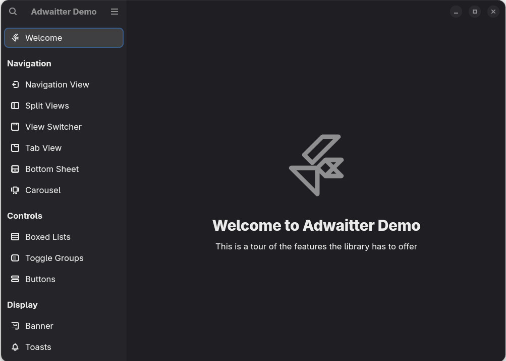 | 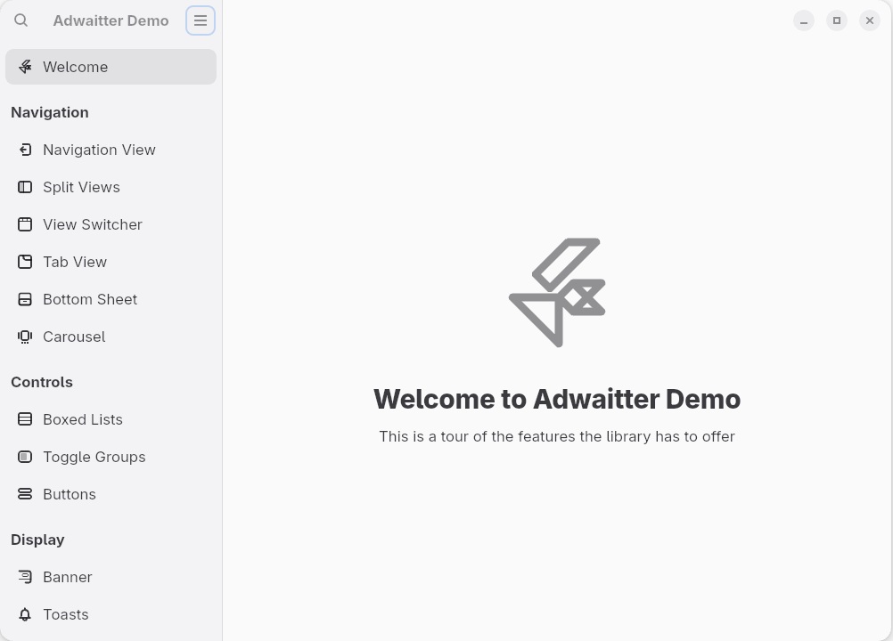 |

| Mobile (Dark) | Mobile (Light) |
| :---: | :---: |
| 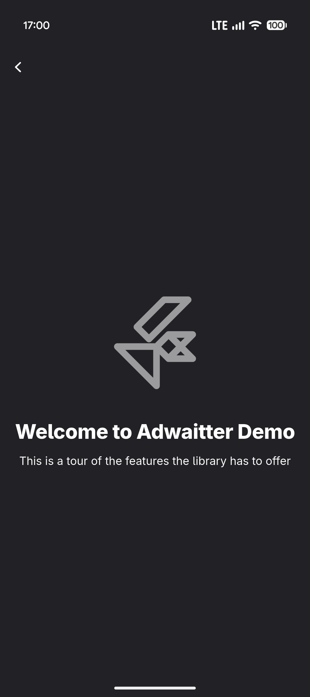 | 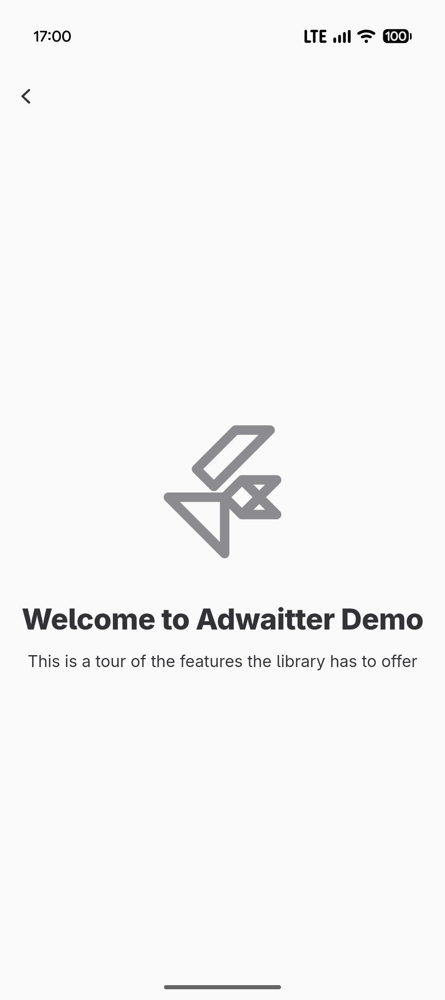 |

### Android Predictive Back Gestures

Smooth spring-physics predictive back gestures across both nested views (`AdwNavigationSplitView` / `AdwNavigationView`) and modals (`AdwBottomSheet` / `AdwDialog`):

| Views & Navigation | Modals & Bottom Sheets |
| :---: | :---: |
| 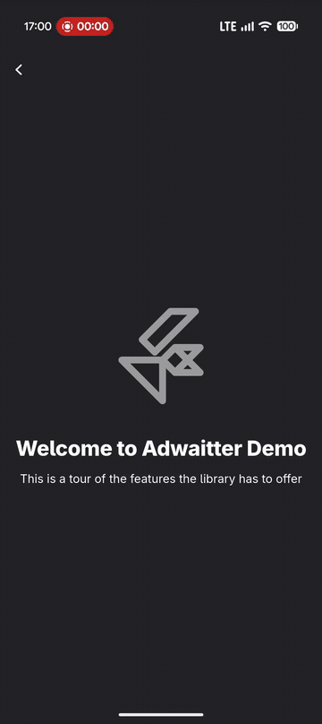 | 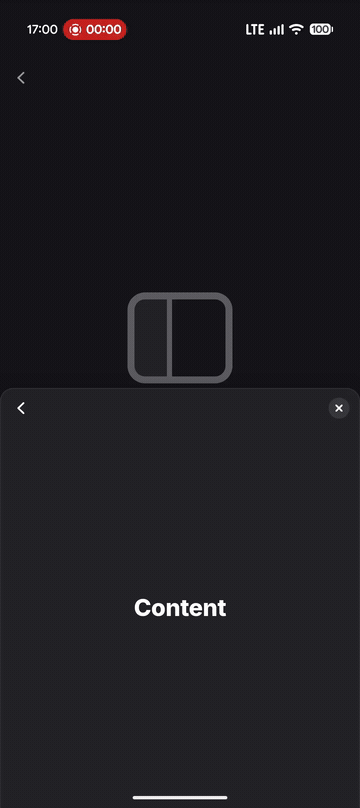 |

### Native Adwaita Animations & Haptic Feedback

Built-in spring simulations (`AdwSpringParams`), Libadwaita easing curves, and native **haptic feedback** on switches, sliders, and gestures on supported platforms (Android/iOS):

**Tab View (`AdwTabView` & `AdwTabBar`)**

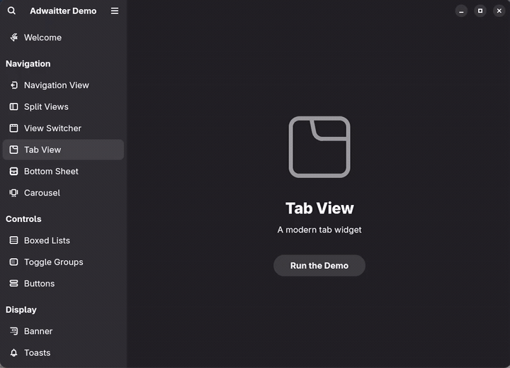

**Navigation View & Modals (`AdwNavigationView` & `AdwDialog`)**

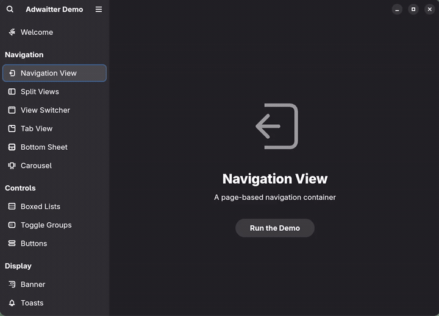

**Carousel & Switches (`AdwCarousel` & `AdwSwitch`)**

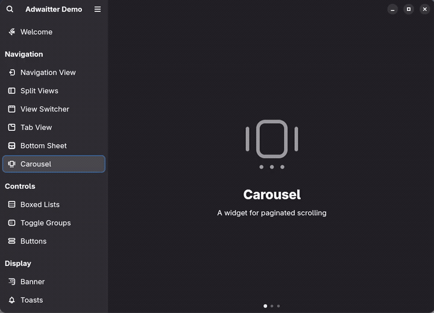

### Integrated Menus & Text Selection

Pure-Flutter GNOME-styled popovers, context menus, and touch text selection toolbars with OSD magnifier:

| Desktop Popovers & Menus | Mobile Text Selection & Menus |
| :---: | :---: |
| 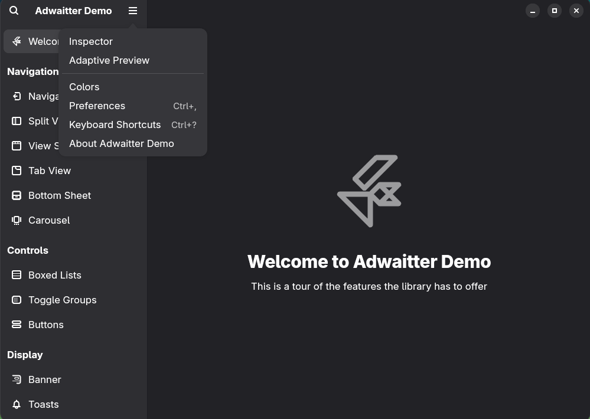 | 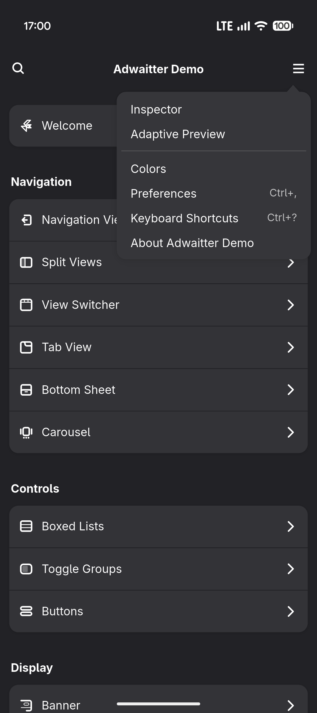 |

---

## Quick Start (UI Counter Generator)

Replace Flutter's default Material counter app (`lib/main.dart`) with a pure Adwaita counter starter in one command:

```bash
dart run adwaitter:setup
```

Options:
- `--title <name>`: Custom window and header bar title (defaults to `pubspec.yaml` `name`).
- `--dry-run`: Preview changes without writing files.
- `--no-backup`: Skip creating `lib/main.dart.bak`.

## Pure-Flutter Platform Behavior

`Adwaitter` requires **no native plugins** and works out of the box on all 6 Flutter platforms using Flutter's built-in APIs:
- Automatic light/dark theme detection, status bar and navigation bar icon contrast (`SystemUiOverlayStyle`), edge-to-edge safe areas, and haptic feedback.
- Built-in accessibility support (`Semantics`, keyboard navigation, focus rings, reduced motion, and Web CSS Media Queries).
- Need native OS bridges (Linux GTK3 CSD, multi-window, XDG Portals, Drag & Drop, System Tray, MPRIS2, Polkit, Android 14+ 2-level contrast, or Material You dynamic accents)? Use **[libadwaitter](https://github.com/CarrsterX/Libadwaitter)**, which re-exports `adwaitter` and provides the native Linux & Android plugins automatically.

## Known Limitations

- **Mobile Web — Browser Edge Back/Forward Gestures (Browser Sandbox Limitation):** On mobile web browsers (Chromium/Brave/Chrome on Android 14+, Safari on iOS), swiping from the physical left/right screen edges is owned by the browser/OS for Back/Forward history navigation (including Chromium's cached page-snapshot transitions). Web platforms do not allow Flutter Web / JS / CSS to disable or intercept these edge gestures or access native predictive-back progress events.
  - To prevent conflicts or double-pop behavior, `AdwNavigationView` excludes a `72px` safe zone on both screen edges on Web; users can swipe back smoothly from the center area of the view or use the `AdwHeaderBar` back button. Native Android builds are unaffected and support Android 14+ Predictive Back natively.
